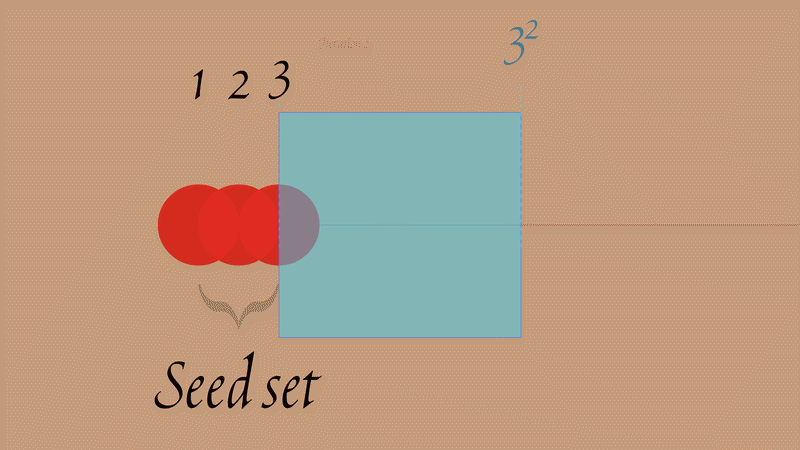
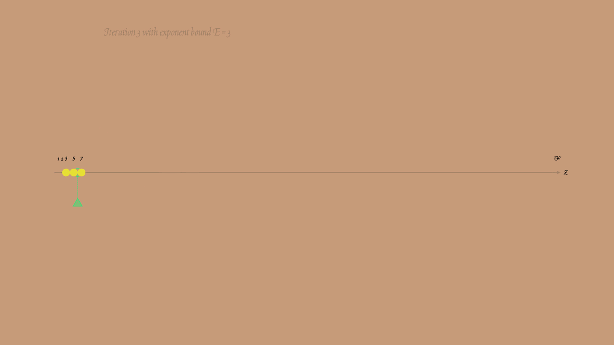

# Prime Partition Algorithm

[](LICENSE)
[](https://zenodo.org/records/20727496)
[](#implementations)

**Grow prime numbers instead of sieving for them.**

Every prime generator you've used works by elimination: list a range of integers, cross out the composites, keep what's left. The Prime Partition Algorithm flips that around. Starting from the seed set `{1, 2}`, it *constructs* new primes algebraically — partitioning the set, exponentiating and multiplying within each half, then combining the results — and lets the set of known primes grow itself, iteration by iteration.

No sieve. No primality test. Just a seed set, a few algebraic operations, and [one observation from Euclid](#why-no-primality-test).



## Overview

A rough version of this technique was originally published [here](https://github.com/EtherBit/A-Most-Curious-Algorithm) and [here](https://github.com/EtherBit/On-Immeasurable-Magnitudes). A formal preprint, *"A Useless Recipe for Primes,"* is available on [Zenodo](https://zenodo.org/records/20727496) and in this repo under [`publication/`](publication).

## The Algorithm in a Nutshell

Starting with a seed set (e.g., `{1, 2}`):

1. **Partition** the set into two groups (all possible ways)
2. **Exponentiate** elements (raise to powers 1–E; the paper grows E by 1 each iteration, the demos fix it at 2)
3. **Multiply** within each group to get two products
4. **Combine** via sum and absolute difference
5. **Keep** candidates in the range `(max, max²]`
6. **Grow** the seed set with newly discovered primes
7. **Repeat** for multiple iterations

Each iteration reaches further into the number line — new primes sprouting from the arithmetic of the ones before them.


### Why No Primality Test?

Step 5 only checks the range. It never tests a candidate for primality, and it doesn't need to. This is the same idea as Euclid's proof that there are infinitely many primes. Every prime in the seed set divides exactly one of the two products, so it can't divide their sum or their difference. That means every candidate has no prime factor ≤ `max`. A composite number below `max²` must have a prime factor ≤ `max`, so as long as the seed set contains every prime up to `max`, every candidate inside `(max, max²]` is prime. (If a prime were ever skipped, say 311, a composite like 311·313 could slip into a later window.)

### The Arithmetic Fulcrum

Step 4 of the algorithm (in the paper) has a nice geometric reading, which I call an *arithmetic fulcrum*. Each partition produces two products: the larger one is a fulcrum on the number line, and the smaller one is its reach. The sum and difference land the same distance away on each side of it. For example, with the seed set `{1, 2, 3, 5, 7}`, the partition `({1, 2, 5}, {3, 7})` gives products 10 and 21. That puts a fulcrum at 21 with a reach of ±10, which balances two primes at once: **11** and **31**.

Several fulcrums work together to fill the quadratic window `(7, 49]`, and some primes get found more than once (over-determined). Here, 37 comes from both the fulcrum at 30 (reach ±7) and the fulcrum at 42 (reach ±5).


For a longer view, [this Manim animation](publication/demo/NumberLineMagnification.mp4) follows the fulcrums across the first 5 iterations as the window keeps growing:



## Quick Start

No dependencies required — grab the Python version and run it:

```bash
git clone https://github.com/microgeant/PrimePartitionAlgorithm.git
cd PrimePartitionAlgorithm/python
python3 prime_partition.py
```

```
=== PYTHON VERSION ===
Hello primes: [3, 5, 7, 11, 13, 17, 19, 23, 29, 31, ...]
Total discovered: 64
Found composites: []
```

## Implementations

The same algorithm, faithfully reimplemented across nine languages — pick the one you're comfortable reading, or compare a few to see how the idea translates across paradigms.

| Language | Source | Notes |
|----------|--------|-------|
| [Python](python) | [`prime_partition.py`](python/prime_partition.py) | Reference implementation, easiest to read |
| [Rust](rust) | [`prime_partition.rs`](rust/prime_partition.rs) | |
| [C](c) | [`prime_partition.c`](c/prime_partition.c) | Includes a `Makefile` |
| [Kotlin](kotlin) | [`PrimePartition.kt`](kotlin/PrimePartition.kt) | |
| [Haskell](haskell) | [`PrimePartition.hs`](haskell/PrimePartition.hs) | |
| [Julia](julia) | [`prime_partition.jl`](julia/prime_partition.jl) | |
| [Scheme](scheme) | [`prime-partition.scm`](scheme/prime-partition.scm) | |
| [Zig](zig) | [`prime_partition.zig`](zig/prime_partition.zig) | Includes a `build.zig` |
| [Jai](jai) | [`prime_partition.jai`](jai/prime_partition.jai) | |

Each directory has its own `README.md` with prerequisites and exact run instructions.

## Repository Layout

```
PrimePartitionAlgorithm/
├── python/, rust/, c/, kotlin/, haskell/, julia/, scheme/, zig/, jai/
│   └── implementation + language-specific README
├── publication/
│   ├── A Useless Recipe for Primes.pdf   # the preprint
│   ├── demo/                             # gifs + Manim animations (.mp4)
│   ├── experiments/                      # faster searches (Python, Kotlin) + run reports
│   ├── prime_synthesis.py
│   ├── PrimeSynthesis.kt
│   └── prime_synthesis_results*.md       # run reports (adaptive + capped schedules)
└── LICENSE
```

## Performance & Limitations


This is a constructive curiosity, not a practical prime generator. Each iteration partitions a seed set of size `n`, raises elements to exponents up to `E`, and filters every combination by range — roughly `2(2E)^n` candidates per step, giving a cumulative cost of `O(N · (2E)^N)` over `N` iterations. Every newly discovered prime makes the next one exponentially more expensive to find (the paper's "Price of Magic").

In practice, [`publication/prime_synthesis.py`](publication/prime_synthesis.py) (the full algorithm from the paper's Listing 1: exponents on both subsets, with an uncapped adaptive exponent schedule) takes **~21 minutes** across 7 iterations to synthesize every prime up to **199** (it reaches as high as 283, but misses 211 and 223) — over 20 of those minutes in the last iteration alone. A Sieve of Eratosthenes finds the same primes in well under a millisecond. Full numbers in [`publication/prime_synthesis_results.md`](publication/prime_synthesis_results.md).

| | Prime Partition Algorithm | Sieve of Eratosthenes |
|---|---|---|
| Complexity | `O(N · (2E)^N)` — exponential | `O(n log log n)` — near-linear |
| Every prime up to 199 | ~21 minutes (0.15 s with [meet in the middle](#experiments)) | microseconds |
| Good for | studying the structure of primes (e.g., how primes are born from their predecessors) | generating primes efficiently |

The sieve wins on every practical axis — see *"The Combinatorial Explosion: An Exponential Barrier"* in [the preprint](publication/A%20Useless%20Recipe%20for%20Primes.pdf).

**A sharper limitation:** the per-language demos hard-code `max_exponent = 2` for speed and readability, but completeness depends on that bound, and whether any bound guarantees it is an open question (the paper's Exponent Conjecture). Capped too low, later iterations silently find *zero* primes instead of erroring: a 13-iteration run capped at `max_exp=2` finds 0 new primes at iteration 12 ([`prime_synthesis_results_capped2_13iter.md`](publication/prime_synthesis_results_capped2_13iter.md)). The adaptive schedule avoids this stall, though it isn't gap-free either.

## Experiments

[`publication/experiments/`](publication/experiments) holds faster searches over the same kind of candidates, each with its run reports. Every candidate still passes only the range check, so none of them needs a primality test.

| Code | What it searches | 15 iterations | Primes found | Gap-free up to |
|---|---|---|---|---|
| [`FulcrumTargetingMitm.kt`](publication/experiments/FulcrumTargetingMitm.kt) | The full algorithm, exact (exponents capped at 5) | 34 s | 115 | 283 |
| [`prime_synthesis_mitm.py`](publication/experiments/prime_synthesis_mitm.py) | Same, in Python | ~8 min | 115 | 283 |
| [`prime_synthesis_left_exp_mitm.py`](publication/experiments/prime_synthesis_left_exp_mitm.py) | Exponents on one subset only (adaptive) | 0.7 s | 77 | 181 |
| [`prime_synthesis_size_bound.py`](publication/experiments/prime_synthesis_size_bound.py) | Both products ≤ X = 10¹², exponents otherwise free | 19 s | 123 | 307 |
| [`prime_synthesis_excess.py`](publication/experiments/prime_synthesis_excess.py) | π_A·π_B = (product of seeds)·k, smooth k ≤ 10⁴ | 2.6 s | 100 | 307 |

- **Meet in the middle:** from `max = 13` on, the sum π_A + π_B always overshoots the window, so only differences of nearly equal products land. Each seed adds `±e·log p` to `log π_A − log π_B`, so the seeds split into two halves that are enumerated separately and matched on their log-ratios, then confirmed exactly with integers. This reproduces the full algorithm iteration for iteration (checked against every report): 7 iterations take 0.15 s instead of ~21 minutes.
- **One subset only:** applying the exponents to one subset of each partition (as in early rough versions, [`prime_synthesis_left_exp.py`](publication/experiments/prime_synthesis_left_exp.py)) is far cheaper but misses more primes: 7 iterations are gap-free only up to 167, vs. 199 for the full algorithm.
- **Patterns:** the exponents that produce primes sit on the smallest seeds (2, 3, 5), and the extra factor `k` is small and smooth. The excess search exploits this.
- **A wall at 311:** every method stops at gap-free 307. A 30-iteration excess run finds nothing new after iteration 13. The expected hits per iteration fall below 1 around iterations 15–17, so the searches dry up rather than fill the gaps.

## Open Questions

- **The Exponent Conjecture:** does some exponent bound guarantee that every prime is eventually found?
- **The wall at 311:** can 311 be built at all as π_A − π_B from the seeds below it, and with what exponents?
- **Wider safe windows:** coprimality alone guarantees primality up to `g²`, where `g` is the smallest prime missing from the seeds, which goes beyond `max²`. A quadratic-residue condition (every prime factor `r` of `π_A − π_B` has `π_A·π_B` as a square mod `r`) may push it further, still without a primality test.

## Citing

If you use this work, please cite the Zenodo preprint (https://zenodo.org/records/20727496):

```bibtex
@misc{kongawi2026useless,
  author    = {Kongawi, Bruno Ziki},
  title     = {A Useless Recipe for Primes: A Partition-Based Algorithm for Prime Synthesis},
  year      = {2026},
  publisher = {Zenodo},
  doi       = {10.5281/zenodo.20727496},
  url       = {https://zenodo.org/records/20727496}
}
```

## License

[MIT](LICENSE)
